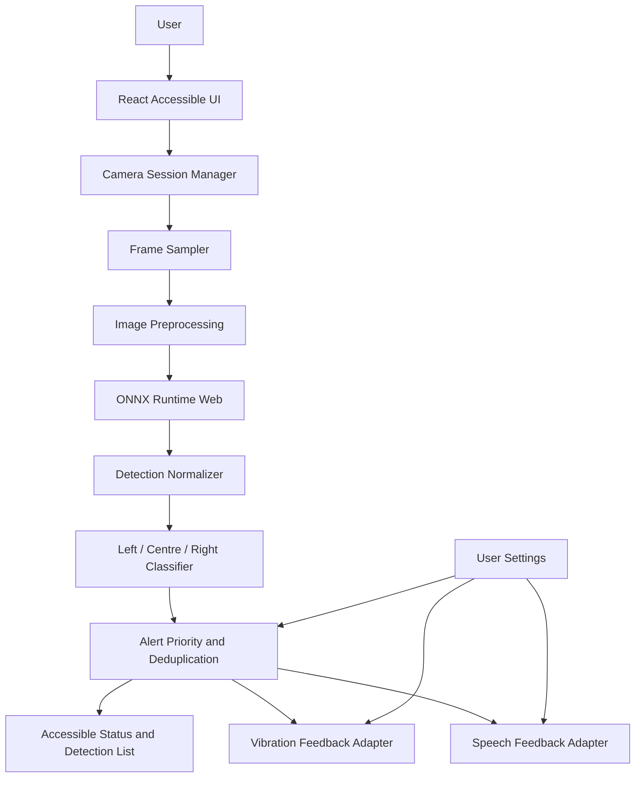

# Veyra — Design Specification

**Version:** 1.0  
**Status:** Draft for review

## 1. Architecture overview

Veyra is a React + Vite Progressive Web App. The browser obtains camera frames through `getUserMedia`, samples frames, and passes them to a local inference layer using YOLO exported to ONNX and ONNX Runtime Web. Detection results are normalized, assigned to left/centre/right camera-view zones, prioritized, and delivered to speech and vibration adapters.

The MVP is local-first and does not require a backend. A FastAPI service is optional for future non-camera functions such as configuration distribution or opt-in account features. Do not route live camera frames through a server in the MVP.



## 2. Suggested repository structure

```text
veyra/
├── .kiro/
│   └── specs/veyra/
│       ├── requirements.md
│       ├── design.md
│       └── tasks.md
├── public/
│   ├── models/                 # model files and model metadata
│   └── icons/
├── src/
│   ├── app/
│   │   ├── App.jsx
│   │   └── routes.jsx
│   ├── components/
│   │   ├── CameraView.jsx
│   │   ├── SessionControls.jsx
│   │   ├── FeedbackSettings.jsx
│   │   ├── DetectionList.jsx
│   │   └── StatusAnnouncer.jsx
│   ├── hooks/
│   │   ├── useCamera.js
│   │   └── useAssistanceSession.js
│   ├── services/
│   │   ├── cameraService.js
│   │   ├── frameSampler.js
│   │   ├── inferenceService.js
│   │   ├── detectionService.js
│   │   ├── zoneClassifier.js
│   │   ├── alertManager.js
│   │   ├── speechService.js
│   │   └── vibrationService.js
│   ├── config/
│   │   ├── modelConfig.js
│   │   └── alertConfig.js
│   ├── styles/
│   └── main.jsx
├── tests/
│   ├── unit/
│   └── e2e/
├── index.html
├── package.json
└── README.md
```

This is a suggested structure. Kiro must inspect the actual repository before creating or moving files and preserve existing conventions.

## 3. Frontend modules

### 3.1 Accessible application shell

- Provide a simple home/onboarding view, assistance session view, and settings view.
- Use semantic buttons and headings, clear focus states, descriptive accessible names, and screen-reader announcements for state changes.
- Primary actions: Start assistance, Pause, Resume, Stop, Enable/disable voice, Enable/disable vibration.
- Do not communicate critical state only through colour or animation.

### 3.2 Camera session manager

Responsibilities:
- Request camera permission only after explicit user action.
- Select an available camera; prefer a rear-facing camera on mobile where supported.
- Maintain explicit states: `idle`, `requesting`, `ready`, `running`, `paused`, `error`, `stopped`.
- Own the `MediaStream` and stop all tracks when the session ends or component unmounts.
- Handle permission denial, device absence, camera-in-use, and browser API errors.

### 3.3 Frame sampler and preprocessing

- Sample frames at a configurable target rate; avoid queuing unlimited inference jobs.
- If inference is busy, drop or replace stale frames rather than building latency.
- Resize and normalize frames according to the selected model's documented input tensor shape and preprocessing rules.
- Keep inference off the main UI thread where supported (e.g. Web Worker); provide a compatible fallback only if performance remains acceptable.

### 3.4 Inference service

- Load a pinned, documented YOLO model exported to ONNX.
- Use ONNX Runtime Web with a supported execution provider and fallback strategy appropriate to target browsers.
- Keep model input size, labels, normalization, output parsing, and confidence threshold in model metadata/configuration.
- Normalize outputs to `{ classId, label, confidence, box: { x, y, width, height } }` with coordinates normalized to the source frame.
- Validate output shape and handle model-load/inference exceptions.
- Do not assume every YOLO export has the same output tensor format; implement and test the parser for the selected model/export.

### 3.5 Zone classifier

Let `centerX = box.x + box.width / 2`. With normalized coordinates from 0 to 1, use configurable boundaries, initially:
- left: `centerX < 0.33`
- centre: `0.33 <= centerX <= 0.67`
- right: `centerX > 0.67`

These zones describe position in the camera image, not the user's physical heading or a safe path.

### 3.6 Alert manager

- Convert detections into alert candidates.
- Apply class priority, confidence threshold, zone, optional validated qualitative proximity, and cooldown.
- Deduplicate by class + zone (and optional track identity if tracking is later added).
- Maintain a short queue and allow high-priority alerts to pre-empt lower-priority alerts.
- Keep alert policy independent of UI and output adapters so it can be unit tested.
- Do not infer collision risk solely from object class or bounding-box size.

### 3.7 Speech adapter

- Wrap `window.speechSynthesis` and `SpeechSynthesisUtterance` behind a small service API.
- Check availability; handle cancellation and voice/language selection gracefully.
- Keep phrases short and configurable.
- Avoid overlapping utterances; allow alert manager to replace queued lower-priority speech.
- Do not auto-speak every detected object.

### 3.8 Vibration adapter

- Wrap `navigator.vibrate` behind a service API.
- Check feature availability and return a supported/unsupported result.
- Use short, documented patterns configurable by alert level.
- Respect the user's setting and browser restrictions.

## 4. Data contracts

### Detection

```ts
type Detection = {
  classId: number;
  label: string;
  confidence: number; // 0..1
  box: { x: number; y: number; width: number; height: number }; // normalized 0..1
  zone: 'left' | 'centre' | 'right';
  timestamp: number;
};
```

### Alert candidate

```ts
type AlertCandidate = {
  key: string;
  label: string;
  zone: 'left' | 'centre' | 'right';
  priority: number;
  confidence: number;
  message: string;
  createdAt: number;
};
```

### User settings

```ts
type AssistanceSettings = {
  voiceEnabled: boolean;
  vibrationEnabled: boolean;
  speechRate: number;
  confidenceThreshold: number;
  inferenceFps: number;
  cooldownMs: number;
};
```

Persist only non-sensitive preferences locally if persistence is needed. Do not persist camera frames or raw audio.

## 5. Model and inference considerations

- Select a compact model suitable for browser inference and document its license, source, class labels, input dimensions, export command, and known limitations.
- Verify ONNX Runtime Web compatibility with the chosen model and target browsers before committing to the model.
- Benchmark CPU and available browser acceleration on representative Android devices and desktop browsers.
- Do not download model weights from untrusted sources.
- Do not claim real-time performance until measured on target devices.

## 6. Privacy and security

- Camera processing is local by default; no frame upload endpoint is part of the MVP.
- Explain camera permission and processing behavior in onboarding.
- Do not add face recognition, identity inference, or biometric features.
- Avoid analytics that capture images, audio, or sensitive environmental information.
- Keep dependencies current and avoid embedding API keys in frontend source.
- Deploy camera features over HTTPS; localhost is suitable for local development.

## 7. Error and fallback states

| Condition | Expected behavior |
|---|---|
| Camera permission denied | Explain how to grant permission; allow retry |
| No camera available | Show a clear unavailable state; no inference starts |
| Camera stream interrupted | Stop sampling, announce interruption, offer restart |
| Model loading failure | Explain AI is unavailable; do not imply detection is active |
| Inference exception | Stop/skip failing inference safely and offer recovery |
| Speech unavailable | Keep visual status and vibration if available |
| Vibration unavailable | Continue voice/visual feedback |
| Browser lacks required API | Explain unsupported capability and suggest a supported browser/device |

## 8. Testing strategy

- Unit tests: zone boundaries, confidence filtering, alert priority, cooldown, deduplication, settings validation, model-output parsing.
- Component tests: accessible labels, session state, permission/error messages, settings controls.
- Integration tests: camera lifecycle, frame sampler to inference adapter using mocked camera/model, alert dispatch to mocked speech/vibration.
- End-to-end tests: onboarding, permission denial, start/pause/resume/stop, settings, responsive layout, keyboard and screen-reader checks.
- Device tests: real Android phones and target browsers; measure inference latency, frame rate, battery/heat, camera behavior, speech and vibration support.
- Safety evaluation: controlled test scenarios with varied lighting, distance, occlusion, motion, and object types. Record false positives and false negatives. Do not conduct unsupervised tests in traffic or hazardous environments.

## 9. Future extension points (not MVP commitments)

- Explicit object-finding mode.
- User-triggered OCR/text reading.
- Bengali and Hindi localization subject to speech voice support and testing.
- Validated depth/proximity signal from supported hardware or a separately evaluated model.
- Optional FastAPI backend for non-camera features only, if a concrete requirement emerges.
- Emergency contact/location workflow only after privacy, consent, reliability, and regional requirements are defined.
